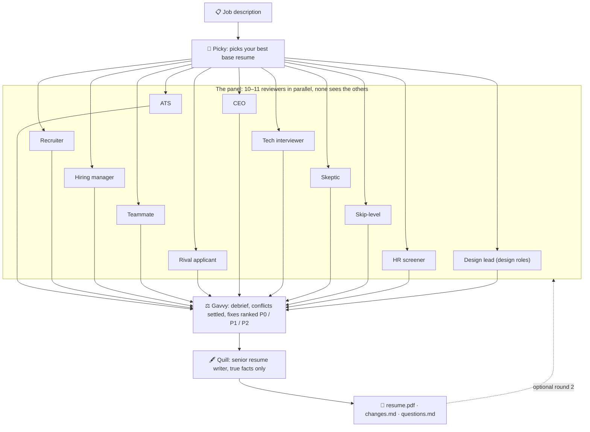

<div align="center">

# Shiro

**Ten hiring-side reviewers (eleven for design roles) try to reject your resume. A writer fixes it using only true facts. Then Claude fills in the application and leaves the Submit button to you.**

A job-application workspace for [Claude Code](https://claude.com/claude-code). It runs on your own Claude subscription and keeps all your data on your computer.

[](LICENSE)
[](https://nodejs.org)
[](https://claude.com/claude-code)


[Quick start](#quick-start) · [How it works](#how-a-review-works) · [The app](#the-app) · [Privacy](#privacy-and-safety) · [FAQ](#faq)

<br>


<sub>Ten reviewers judge the resume, Gavvy ranks the fixes, Quill rewrites it. Made-up demo data.</sub>

</div>

---

## Why Shiro

Most resume tools tell you your resume is great. Hiring doesn't work that way. A recruiter skims it for seven seconds, an ATS looks for keywords, a hiring manager looks for proof, and a skeptic looks for inflated claims. Each of them has a different reason to say no.

Shiro puts all of them in one room. They review your resume against one specific job, independently, and each one tries to reject it. A debrief chair merges what they found into one ranked fix plan. Then a senior resume writer rewrites the resume, using only facts from your own career memory.

|  |  |
|---|---|
| 🎯 **One job at a time** | Every review is against a real job description, not a generic checklist. |
| 🧑‍⚖️ **Ten hiring perspectives** | ATS, recruiter, hiring manager, teammate, rival applicant, CEO, technical interviewer, skeptic, skip-level manager and HR screener. |
| ✍️ **Never invents anything** | Every line traces back to your resume or your memory. When a fix needs a fact it doesn't have, the writer asks you instead of guessing. |
| 📄 **A PDF that's ready to send** | The tailored resume is built as an ATS-safe, single-column PDF. It's fitted to one page automatically, and every link is clickable. |
| 🧠 **A career memory that grows** | Jobs, projects, certificates, skills, documents and form answers, kept in plain Markdown files on your computer. |
| 🤖 **Fills applications for you** | Claude fills the form in Chrome from your memory, uploads the right files and drafts open answers. Then it stops so you can check and submit. |
| 🔑 **No API keys** | It runs through Claude Code on your Pro or Max plan. Nothing is hosted, and there's no account to make. |

## Quick start

**You need:** a Claude **Pro** or **Max** plan, [Claude Code](https://claude.com/claude-code) signed in (run `claude`, then `/login`), and Node.js 18 or newer. There's nothing to `npm install`.

```bash
git clone https://github.com/priyansh1210/shiro.git
cd shiro
npm run ui          # opens the app at http://127.0.0.1:4747
```

1. **Memory tab:** drop in your resume, then press **Set up my profile**. Claude reads it and asks you a few questions.
2. **Review tab:** paste a job description or a job link, then press **Start review**.
3. **Apply tab:** paste the application link. Claude fills the form in Chrome, and you review it and submit.

You don't need the app. The same steps work as commands inside Claude Code:

```text
/setup  path/to/your-resume.pdf
/review https://company.com/careers/some-job
/apply  https://company.com/careers/some-job/apply
```

> **Tip:** press **Play demo** on any tab to watch the whole flow with made-up data. It uses no tokens.

## How a review works



Each reviewer gives a verdict (**REJECT**, **MAYBE** or **ADVANCE**), a score out of 10 and specific fixes:

| Reviewer | How they reject you |
|---|---|
| **ATS** | Can't parse the file, knockout criteria, missing keywords |
| **Recruiter** | Seven-second skim, must-have checklist, "can I sell this person?" |
| **Hiring manager** | No proof you've done the work this team needs |
| **Teammate** | More talk than building, stack mismatch, would need carrying |
| **Rival applicant** | A realistic top-10% competitor showing where they'd beat you |
| **CEO** | No impact, no ownership, forgettable |
| **Technical interviewer** | Claims you couldn't defend, plus the questions they'd ask |
| **Skeptic** | Inflated verbs, suspicious numbers, inconsistent dates |
| **Design lead** | Design roles only: no evidence of craft, user thinking, process or product impact |
| **Skip-level manager** | Wrong level for the role, flat trajectory |
| **HR screener** | Eligibility, gaps, missing basics, things that shouldn't be there |

**The writer works like a senior resume writer.** It fixes the stage where the debrief says your resume gets rejected first. It treats the debrief's rulings as final and makes sure the job's must-haves show up in the top third of the page. It also plans the page before writing and checks its own work: every number has a source, nothing is inflated, and the resume stays within its length.

Every run is saved in its own folder:

```text
runs/2026-11-07-acme-backend-engineer/
├── jd.md                 the job description
├── pick.md               which base resume it started from, and why
├── feedback/             one report per reviewer
├── debrief.md            scoreboard and ranked fix plan
├── resume.md / .html     the new resume
├── resume.pdf            ready to upload (fitted to one page, blue links)
├── changes.md            each fix, its status, and where the fact came from
└── questions.md          what the writer needs from you to do better
```

## The app

A local web page where you can watch the crew work. Each agent is a small animated character: Picky picks, the panel stamps verdicts, Gavvy runs the debrief and Quill writes.

- **Review.** Switch each of the 14 agents on or off (the design lead starts off; switch it on for design roles), and choose its model (Sonnet, Opus, Haiku) and effort. The recommended mix uses Sonnet for the reviewers and Opus for the debrief and the writer. Click any character to read their full report.
- **Apply.** Fillo fills the form in your Chrome, live, and stops before Submit.
- **Memory.** Browse your whole career memory by file and search across all of it. Add resumes, certificates, transcripts and links. **Remove anything with one click and undo it.** You can also tell Memo what to forget in plain words.
- **Usage meters** show your 5-hour and weekly Claude limits, the same numbers as `/usage`, and refreshing them is free.
- **Animations are free.** The characters are plain browser code. Tokens are only used when an agent actually works.

## Commands

| Command | What it does |
|---|---|
| `/setup [resume]` | Builds your private career memory from your resume, then asks what application forms usually need (work authorization, notice period, links…). |
| `/review [JD file or URL] [resume]` | Runs the rejection panel for one job and writes a tailored resume. |
| `/apply <URL> [resume]` | Fills the application in Chrome. **It never submits.** |
| `/remember <anything new>` | Saves a new job, course, certificate, project, skill, award or answer. Start with `FORGET:` to remove something instead. |

Rather than typing `/remember`, you can just mention something new while talking to Claude Code in this folder ("I finished the AWS certificate") and it updates your memory.

## Your career memory

`memory/` is the single source of truth about you, and it holds more than any one resume can:

```text
memory/
├── profile.md         contact, links, work authorization, availability, resume preferences
├── experience.md      every job, internship, freelance and research role
├── education.md       degrees, coursework, GPA
├── projects.md        personal, academic and hackathon projects
├── certifications.md  certificates and courses
├── skills.md          each skill, with where you actually used it
├── achievements.md    awards, competitions, leadership, talks
├── answers.md         your answers to form questions, reused by /apply
├── applications.md    every application Shiro filled, with its status
├── documents.md       what each saved file and link is for
├── documents/         certificates/ academic/ letters/ portfolio/ …
└── resume/            your base resumes, one per kind of role
```

- **Several base resumes.** Keep one per kind of role. Each review and application starts from the best match for that job.
- **Your preferences stick.** Write preferences such as "one page" or "blue links" under `Resume preferences` in `profile.md`, and every resume follows them.
- **Memory wins.** When a resume and memory disagree, memory wins, unless the resume has something newer that memory doesn't have yet. In that case Shiro saves the new fact.
- **They're plain files.** You can read them, edit them or back them up. Restarting the app never touches them.

## Privacy and safety

- **Local first.** The app listens on `127.0.0.1` only. `memory/` and `runs/` are git-ignored, so your personal data is never committed, even if you fork this repo and push it.
- **Your data only goes where you send it:** to Claude, as in any Claude Code session, and into the one application form you asked it to fill.
- **It never submits, creates accounts, types passwords, solves CAPTCHAs or accepts terms for you.** You stay in control of every application.
- **No sensitive IDs.** Shiro refuses to save passwords, government ID numbers or bank details, and never uploads identity documents.
- **It never fabricates.** The writer and the form filler only use facts you've given them. Anything drafted is marked as a draft.

## Usage and cost

A full review runs 12–14 agents. With every agent on Opus it used about **16% of a Pro plan's 5-hour session**. Using the recommended mix, switching off reviewers you don't need, or lowering efforts all make it cheaper. After every review, the app shows how much of your session that run used. Memory and Apply default to Sonnet at low effort, because they're mostly look-up work.

## Customize

- **Add a reviewer:** copy any file in `.claude/agents/`, change the persona and its "How you reject" section, and add the agent to the panel lists (`.claude/skills/review/SKILL.md`, `ui/review-pipeline.mjs` and `ui/public/creatures.js`).
- **Change the resume design:** edit `templates/resume.html`. Keep it single-column so ATS parsers can read it.
- **Change the writer's rules:** edit `.claude/agents/resume-writer.md`.

## FAQ

<details>
<summary><b>Do I need an Anthropic API key?</b></summary>

No. Shiro runs through Claude Code, which uses your Claude Pro or Max subscription. There's nothing to configure.
</details>

<details>
<summary><b>Will it apply to jobs automatically?</b></summary>

No, on purpose. It fills the form and stops. You read every field and press Submit yourself. It also isn't meant for LinkedIn Easy Apply or other sites whose terms forbid automation.
</details>

<details>
<summary><b>Are the reviewers what real companies think?</b></summary>

They simulate how each role reads a resume, and they're often uncomfortably accurate. Still, treat them as a sharp second opinion, not as the verdict of any specific company.
</details>

<details>
<summary><b>Which application sites does /apply work on?</b></summary>

Company career pages, including Greenhouse, Lever, Ashby, Workday, SmartRecruiters and custom forms. You need Google Chrome with the Claude in Chrome extension. When a site asks you to log in or solve a CAPTCHA, Shiro waits for you.
</details>

<details>
<summary><b>How do I remove something from memory?</b></summary>

In the Memory tab, click the bin icon next to any item, document, link or resume, then confirm. You can undo it from the message that appears. Or switch to **Forget** and describe what to remove. From Claude Code, use `/remember FORGET: the Domain Trail project`.
</details>

## Project layout

```text
.claude/agents/   the 14 agents: picker, 11 reviewers, debrief, writer
.claude/skills/   /setup, /review, /apply, /remember
ui/               the local web app (no build step, no dependencies)
tools/            free local helpers: resume text, resume → HTML → PDF, document filing
templates/        blank memory files, the resume and cover-letter templates
```

## Contributing

Issues and pull requests are welcome, especially new reviewer personas, better resume templates and support for more application forms. Start with [CONTRIBUTING.md](CONTRIBUTING.md), and use the [issue templates](https://github.com/priyansh1210/shiro/issues/new/choose) to report a bug or suggest a reviewer. Please keep personal details out of agents, skills and templates: they're shared with everyone who uses Shiro.

## License

[MIT](LICENSE) © 2026 Priyansh Kabra

<div align="center"><sub>Shiro is an independent project and is not affiliated with Anthropic. Always read your resume and every application before you send it.</sub></div>
